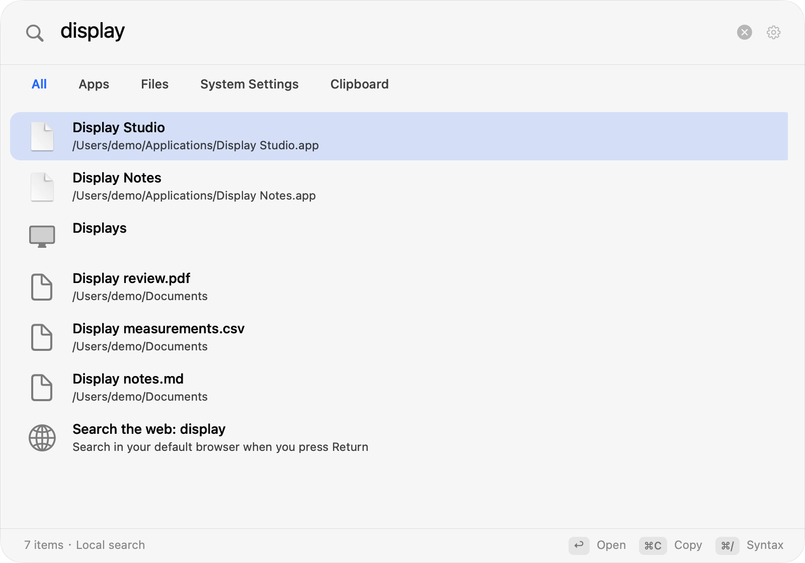
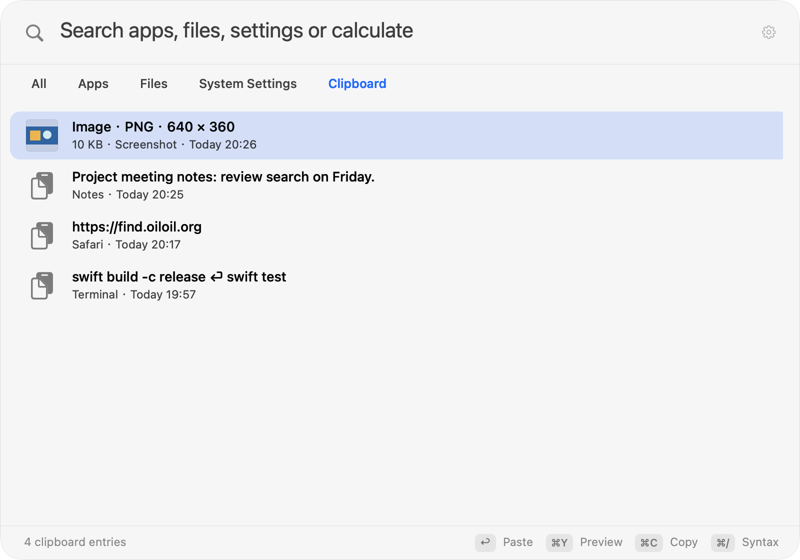
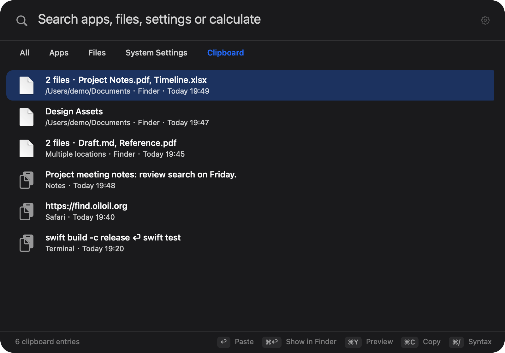
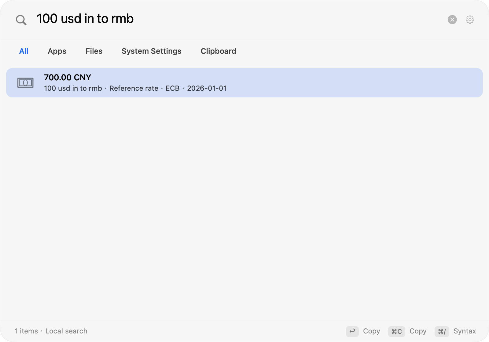
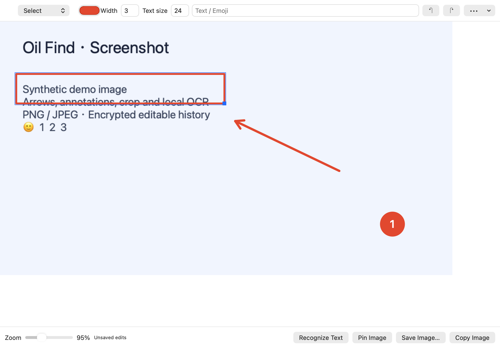

<p align="center">
  <a href="https://github.com/Sigurd-git/oil-Spotlight"><b>Fork source</b></a>
  &nbsp;·&nbsp;
  <a href="https://find.oiloil.org/en">Website</a>
  &nbsp;·&nbsp;
  <a href="./README.zh-CN.md">简体中文</a>
</p>

This repository is a public fork of [upstream Oil Find](https://github.com/oil-oil/oil-find). It retains upstream multi-source extensions and the Pro website flow, and adds unified search and clipboard history. Fork builds disable the upstream official app-update channel; they do not check for or install upstream app updates. Build from this fork's source; upstream releases are described in the Pro section below.

Oil Find is a native macOS search panel. Press ⌘Space by default. If that shortcut cannot register because of Spotlight, the app temporarily tries ⇧⌘F and provides a Spotlight settings link, directions and retry in Settings. You can also turn off the Spotlight search shortcut in System Settings → Keyboard → Keyboard Shortcuts → Spotlight. Upgrades preserve an existing custom shortcut.

All file-name search features are in the free, open-source version. External drives are searchable while connected; after you unplug one, its files are no longer searchable in the free version. Searching unplugged drives and image or document contents is part of the separate paid upstream [Oil Find Pro](#oil-find-pro) add-on. Unified search, clipboard history and Spotlight shortcut handling are part of this fork's macOS app.

## Why it's fast

- **File names live in one contiguous block of memory.** Hundreds of thousands of names are stored column by column and scanned front to back, with no per-file objects.
- **Matching runs in C with NEON.** Character comparisons use Apple silicon's vector instructions in batches.
- **Results narrow incrementally.** Typing one more character only searches what already matched.
- **Only changes get updated.** FSEvents reports what changed and the index is updated incrementally. After a restart, Oil Find catches up from where it left off.

Dependency folders, app and package internals, Library and system folders are excluded by default. You can adjust the index scope in Settings. File search supports pinyin, name and path conditions, wildcards, and kind, size and modification-date filters.

## Other search scopes

The panel offers All, Apps, Files, Settings and Clipboard scopes, switchable with ⌘0…⌘4. Use ⌥⌘1…9 for file-type filters. File results retain Quick Look, path copying, Finder reveal and drag-and-drop.

Press ⌘⌫ to clear the entire search field. By default, a query expires after the panel has been closed for 1 minute and clears on the next opening. Brief app switches keep it; it never clears while you are typing. In Settings → Search → Clear Search Query, choose immediately after closing, 1 minute, 5 minutes, 15 minutes, or always keep. Scope and filter preferences remain selected.



Clipboard history is off by default and starts recording only after you first enable it. It records eligible text and links, raster images from the clipboard, and path references to local files and folders. Upgrades preserve your enabled state and preferences, and existing text history remains compatible with the encrypted archive. A group of files copied in Finder becomes one history entry; the list shows names and a count, and you can search by file name or path. A copied screenshot or other supported clipboard image is kept in its original encoded format with format and pixel-dimension metadata. PNG, JPEG, TIFF, GIF, HEIC, WebP, BMP and other raster formats decodable by system ImageIO are supported; each image is limited to 16 MiB and 64 megapixels. Images are not OCR-processed or sent over the network. Finder copies of image files remain path references and are not read.

Image entries show a thumbnail and support preview with ⌘Y. Press ⌘C to restore the actual image to the system clipboard, preserving its original representation and adding a compatible PNG when it fits the image limit. Return follows the existing target-app, focus and Accessibility permission checks before attempting to paste; if a check fails, the entry is only copied to the system clipboard and the app tells you. Select a file history entry and press ⌘C to restore the whole group as file URLs, then return to Finder and press ⌘V to copy the files. History stores file paths without backing up files or reading their contents. Files moved or deleted from those paths cannot be recovered from history. Before copying, the app checks every file in the group on a background queue. A missing path or a two-second deadline preserves the current clipboard. Changing the query, selected entry or panel state cancels the pending action before any write.



Default retention is 7 days and up to 500 entries, configurable to 1–365 days and 1–10,000 entries. Each text entry is limited to 256 KiB in UTF-8. Each file entry allows up to 1,000 paths with a combined UTF-8 size of at most 256 KiB. Total history storage remains limited to 32 MiB. History, including image bytes and file path references, is encrypted locally and protected with Keychain. Password managers are excluded by default; you can exclude other source apps, pause capture or clear history. File promises whose contents have not yet been generated and items marked concealed, transient or autogenerated are not captured.

If Keychain access fails, the original encrypted file is preserved, new entries stay in memory, and Settings shows the storage error. Click “Authorize History Storage” to request system authorization. After the original history loads successfully, it is merged with current entries and saved; failed authorization never overwrites the original file.



Expression calculations and unit conversions work offline. Enter a URL to open it. DuckDuckGo is the default web search engine, with Google and Bing as options. Choose a web result for a regular query or enter `web:` to request web search explicitly; the browser opens only when you activate that result. Typing does not send queries to a search engine.

In All, enter `100 usd in to rmb`, `100 USD to CNY`, or `100美元转人民币` to convert currencies; RMB is an alias for CNY. Results use [ECB daily reference rates through Frankfurter](https://frankfurter.dev/), show the rate date, and can be copied with Return or ⌘C. The first complete currency expression asynchronously fetches a fixed currency list; amounts and full queries remain on this Mac. Ordinary file searches, calculations, and unit conversions do not request exchange rates. Public rates are cached locally for 24 hours and refreshed in the background when expired. Cached results are labeled when the service is unavailable; without usable rates, press Return to retry. Reference rates exclude bank fees and live trading prices. Currency Conversion can be disabled in Settings → Search.



## Native screenshot tools

Press **⌘⇧4** or search for “screenshot”. Capture a region, window, display or manually scrolled page, then edit before copying, saving PNG / JPEG or pinning. The editor supports arrows, shapes, steps, text, pen, highlights, mosaic, opaque redaction, crop, Emoji, stickers, reusable annotation materials, undo and redo. Open image files, clipboard images or editable screenshot history to continue. Vision OCR runs locally only when requested. Pins support resizing, opacity and all-desktop display, and last for this session.

Screenshot history is independent of clipboard history: encrypted defaults of **7 days, 100 images, 256 MiB**; disable or adjust it in Settings → Capture. Editable history keeps the original **before redaction**; exported images contain flattened pixels only. The first capture needs Screen Recording permission. If macOS occupies ⌘⇧4, the Capture settings explain how to disable the matching system shortcut; search and menu entries remain available. See [capture behavior, limits and privacy](./docs/CAPTURE.md).



## Search syntax

| Type | Meaning |
| --- | --- |
| `wd`, `wendang` | Pinyin initials or full pinyin, finds 文档 |
| `foo bar` | Contains both foo and bar |
| `foo \| bar` | Contains foo or bar |
| `readme !node_modules` | Contains readme, not inside node_modules |
| `*.png` | Wildcards match the whole name |
| `~/Desktop/ png` | Only under the Desktop |
| `ext:pdf;docx` | By extension |
| `kind:image` | By kind: folder, app, doc, image, video, audio, code, archive |
| `file:`, `folder:` | Files only, or folders only |
| `size:>10mb`, `size:1mb..5mb` | By size |
| `dm:today`, `dm:week`, `dm:2026-10-01` | By modification date |
| `regex:^IMG_\d+` | Regular expressions |

You can paste paths straight from a terminal or editor: `file://` URLs, quoted or escaped paths and paths ending in `:line:column` all work. Press ⌘/ in the search field for a syntax reference.

## Keyboard

| Key | Action |
| --- | --- |
| <kbd>⌘</kbd><kbd>Space</kbd> | Open search (default) |
| <kbd>⇧</kbd><kbd>⌘</kbd><kbd>F</kbd> | Temporary fallback if ⌘Space cannot register |
| <kbd>⌘</kbd><kbd>0</kbd>…<kbd>4</kbd> | Switch All, Apps, Files, Settings and Clipboard scopes |
| <kbd>⌥</kbd><kbd>⌘</kbd><kbd>1</kbd>…<kbd>9</kbd> | Choose file type |
| <kbd>Return</kbd> | Execute the result: open, copy a calculation, or paste a clipboard entry |
| <kbd>⌘</kbd><kbd>Return</kbd> | Files: show in Finder |
| <kbd>⌘</kbd><kbd>Y</kbd> | Files: Quick Look; clipboard: preview text or image |
| <kbd>⌘</kbd><kbd>C</kbd> | Copy selected query text first, otherwise the result's path, text or URL; clipboard images and file groups restore usable clipboard representations |
| <kbd>⌥</kbd><kbd>⌘</kbd><kbd>C</kbd> | Files: copy name |
| <kbd>⌘</kbd><kbd>⌫</kbd> | Clear the entire search field; use the context menu to delete files or clipboard entries |
| <kbd>Tab</kbd> | Cycle file types in the Files scope |
| <kbd>⌘</kbd><kbd>/</kbd> | Syntax reference |

You can also drag results into other apps.

## Oil Find Pro

The Pro features, downloads and licensing described here refer to [upstream releases](https://github.com/oil-oil/oil-find/releases). Building this fork from public source does not include Pro, and its official app-update channel stays disabled.

The public app code is licensed under MIT. Oil Find Pro is a separate closed-source paid add-on: $9.99 once (¥49 in mainland China), with a 7-day free trial. The free version stays free and open source; Pro and Free use the same download.

| | Free | Pro |
| --- | :---: | :---: |
| Search by file name: pinyin, wildcards, regex, filters by kind, size and date | ✓ | ✓ |
| Live updates, Quick Look, drag and drop, full keyboard control | ✓ | ✓ |
| Excluded folders and file types, in-app updates | ✓ | ✓ |
| External drives: indexed and searchable while plugged in | ✓ | ✓ |
| External drives stay searchable after unplugging | | ✓ |
| Image content: text and objects in screenshots and photos | | ✓ |
| Document content: PDF, Word, PowerPoint, Excel, Pages, Markdown and more | | ✓ |
| Source code | Open source, MIT | Closed source |
| Price | Free | $9.99 once (¥49 in mainland China) |

Pro and the free version are the same download:

- After downloading from Releases or the website, every free feature works right away and never expires, with no activation.
- To use Pro, open the Oil Find Pro section in Settings and click Start 7-Day Free Trial, or enter a license key. When a trial ends, only Pro features turn off.
- Building from source gives you the free version, without Pro.
- Images and documents are processed on your Mac and never uploaded.

Buy it or read more at [find.oiloil.org/en/pro](https://find.oiloil.org/en/pro).

## Install

1. Download `Oil-Find.zip` from [Releases](https://github.com/oil-oil/oil-find/releases/latest), unzip it and drag Oil Find into Applications.
2. The first time you open it, macOS blocks it because it isn't notarized by Apple. Go to System Settings → Privacy & Security and click Open Anyway near the bottom.
3. Press ⌘Space and start typing. If the shortcut cannot register, the app temporarily tries ⇧⌘F. You can adjust the Spotlight shortcut in System Settings as described above, then retry from Oil Find's Settings.
4. Optional: grant Full Disk Access to also search mail attachments and other apps' data. Oil Find works fine without it.

Fork builds disable the upstream official app-update channel. They do not notify you about or install upstream releases; use a build published by this fork, when available, or build from source.

Source users can run `scripts/uninstall.sh` and confirm removal of the app, local index, clipboard history, preferences and clipboard encryption key. For manual removal, quit Oil Find and delete it from Applications and `~/Library/Application Support/Oil Find`; you can also remove the `com.oiloil.find.clipboard-history` Keychain item.

## Build from source

The app runs on macOS 14 or later. Source builds require Xcode with macOS SDK 15.4 or later; CI uses Xcode 16.4 (macOS 15.5 SDK). The project retains Swift 5 language mode and a macOS 14 deployment target.

```sh
git clone --branch codex/spotlight-launcher https://github.com/Sigurd-git/oil-Spotlight.git
cd oil-Spotlight
swift test
scripts/build-app.sh   # builds build/Oil Find.app
scripts/install.sh     # builds and installs into Applications
```

Set `OILFIND_BUILD_SYSTEM` to select a SwiftPM backend. With recent Command Line Tools, if the default backend writes an SDK marker that fails release verification, use `OILFIND_BUILD_SYSTEM=native scripts/build-app.sh`. The same option applies to the install and clipboard-upgrade scripts. The complete XCTest suite still needs the test frameworks supplied by Xcode.

Without a stable signing identity, source builds are ad-hoc signed. Rebuilding may require granting Full Disk Access and access to an existing clipboard key again. If Clipboard Settings shows a storage error, click “Authorize History Storage” and complete the macOS Keychain prompt manually. Failed authorization preserves the original encrypted history; new entries remain in memory.

Before submitting a PR, run `scripts/verify-release-app.sh "build/Oil Find.app"` to check the release bundle. `scripts/verify-clipboard-upgrade.sh` uses an isolated keychain and a temporary stable signing identity to verify real encrypted history across shutdown and upgrades, without accessing the user's history. `scripts/compare-engine-performance.py` compares release file engines; see the [validation record](./docs/SPOTLIGHT_VALIDATION.md) for usage and measurement limits.

## Privacy

- The file-search engine reads file names, sizes and modification dates only, never file contents; its index stays on your Mac in `~/Library/Application Support/Oil Find/`. Pro image and document processing also stays on your Mac.
- Clipboard history is off by default. When enabled, it saves eligible text, links, supported clipboard images and local file/folder path references, encrypted locally and protected with Keychain. Images retain their original encoded bytes and are not OCR-processed or sent over the network; Finder image-file copies remain path references. File references store paths without reading contents or backing up files. You can pause, clear or exclude source apps; upgrades preserve your enabled state and preferences.
- The source app is estimated from the frontmost app at copy time, so not every sensitive item can be identified. If the key is unavailable or history is damaged, the original file is preserved, an error is shown and new entries stay in memory.
- Web search defaults to DuckDuckGo, with Google and Bing as options. A normal query can offer a web-search result, or use `web:` to request one explicitly. The search engine opens only when you execute that result; typing does not send queries.
- Currency Conversion can be turned off in Search settings. A complete currency expression asynchronously requests a fixed list of public ECB rates through Frankfurter, without amounts, full queries, clipboard data, or file contents. Its cache stores only public rates, source dates, and retrieval time; results show the reference date and cache status.
- Fork builds do not connect to the upstream official app-update service. Pro periodically verifies its license online, sending only the license key, device identifier and device name.

## Current limits

- Apple silicon and macOS 14 or later only.
- Free file search matches names only. External drives are searchable while connected; searching them after unplugging, plus image or document content search, is part of upstream Oil Find Pro. Network volumes are not supported yet.
- Clipboard history is an optional, separate feature; file entries store path references. Moved or deleted files cannot be recovered. If a path check fails for the group, the current clipboard is preserved and you are asked to copy the files again.

## Project layout

| Folder | Contents |
| --- | --- |
| `Sources/COilFind` | C: batched directory reads, name comparison, search scoring |
| `Sources/OilFindCore` | Scanning, indexing, file queries, live updates, persistence and app updates |
| `Sources/OilFindApp` | AppKit app library, search panel, cross-source coordinator, clipboard and system integration |
| `Sources/OilFind` | Executable app assembly entry point |
| `Sources/oilfind-cli` | Command-line tool for benchmarks and troubleshooting |
| `site` | The website, [find.oiloil.org](https://find.oiloil.org/en) |

See [docs/ARCHITECTURE.md](./docs/ARCHITECTURE.md) for the index design and [AGENTS.md](./AGENTS.md) for development conventions.

## Contributing

Issues and pull requests that improve file search and unified search are welcome in this fork. Upstream focuses on file search; Pro features for searching files on unplugged external drives and searching image or document contents are maintained privately, and upstream does not accept pull requests implementing those features.

See [docs/SPOTLIGHT_VALIDATION.md](./docs/SPOTLIGHT_VALIDATION.md) for this extension's automated, performance and hardware validation scope.

## License

The code in this repository is licensed under [MIT](./LICENSE). The Pro module isn't in this repository and isn't open source; the builds on Releases and the website include it.
